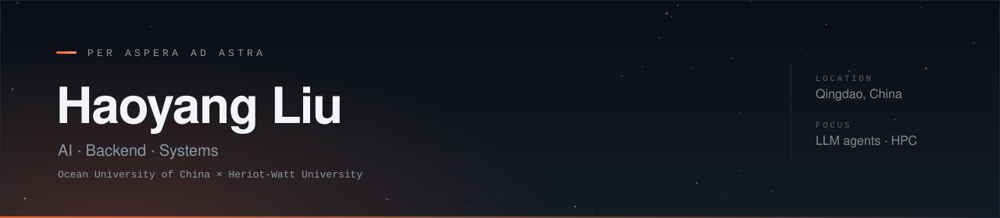
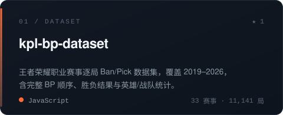
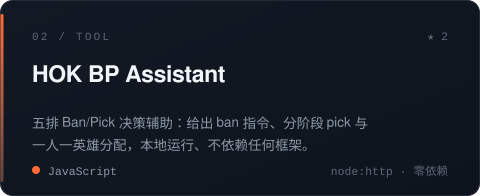
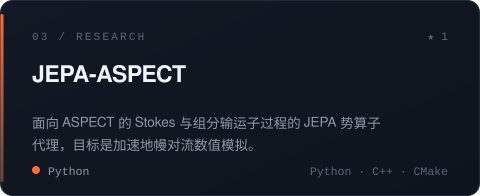
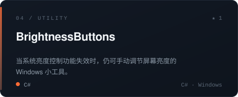

  <a href="https://github.com/Fire-Phoenixs">
    <picture>
      <source media="(prefers-color-scheme: light)" srcset="https://raw.githubusercontent.com/Fire-Phoenixs/Fire-Phoenixs/main/assets/banner-light.svg">
      
    </picture>
  </a>

 

就读于中国海洋大学与 Heriot-Watt University，方向是 AI 与后端系统。日常在写 LLM agent 的工具链、给地学数值模拟做代理模型，以及一些把“数据有意思地呈现出来”的小系统。

相信好的工程是**能被别人接手和验证的工程**：所以下面这些仓库大多附带数据快照、可复现的构建脚本和验收用例，而不是只留一份跑不通的 demo。

### 精选项目

  <a href="https://github.com/Fire-Phoenixs/kpl-bp-dataset"><picture><source media="(prefers-color-scheme: light)" srcset="https://raw.githubusercontent.com/Fire-Phoenixs/Fire-Phoenixs/main/assets/card-p1-light.svg"></picture></a>
  <a href="https://github.com/Fire-Phoenixs/honor-of-kings-bp-assistant"><picture><source media="(prefers-color-scheme: light)" srcset="https://raw.githubusercontent.com/Fire-Phoenixs/Fire-Phoenixs/main/assets/card-p2-light.svg"></picture></a>
   
  <a href="https://github.com/Fire-Phoenixs/JEPA-ASPECT-Hybrid-Acceleration-Framework"><picture><source media="(prefers-color-scheme: light)" srcset="https://raw.githubusercontent.com/Fire-Phoenixs/Fire-Phoenixs/main/assets/card-p3-light.svg"></picture></a>
  <a href="https://github.com/Fire-Phoenixs/BrightnessButtons"><picture><source media="(prefers-color-scheme: light)" srcset="https://raw.githubusercontent.com/Fire-Phoenixs/Fire-Phoenixs/main/assets/card-p4-light.svg"></picture></a>

  另有 <a href="https://github.com/Fire-Phoenixs/dsh-purge-plus">dsh-purge-plus</a>（LLM 工具链分支）、<a href="https://github.com/Fire-Phoenixs/OhMyGit-ZH">OhMyGit-ZH</a>（Git 教学游戏汉化）与 <a href="https://github.com/Fire-Phoenixs?tab=repositories">全部仓库 →</a>

### 技术栈

  日常主力是 <b>Python</b> 与 <b>JavaScript</b>，系统层用 <b>C++</b> / <b>C#</b>；正在补分布式系统与编译原理。

<i>Per Aspera Ad Astra</i> — 循此苦旅，以达星辰。

<!-- ============================================================
     可选：贡献贪吃蛇（每天由 .github/workflows/snake.yml 生成）
     想启用就把下面这一整段取消注释。注意：提交数少时这张图会很空。
     ============================================================

  <picture>
    <source media="(prefers-color-scheme: light)" srcset="https://raw.githubusercontent.com/Fire-Phoenixs/Fire-Phoenixs/output/github-snake.svg">
    
  </picture>

-->
